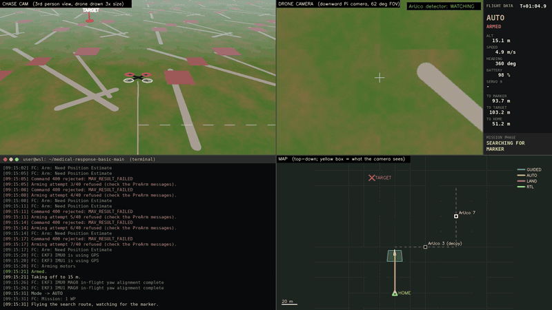
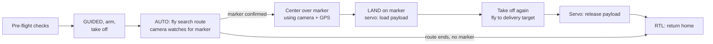
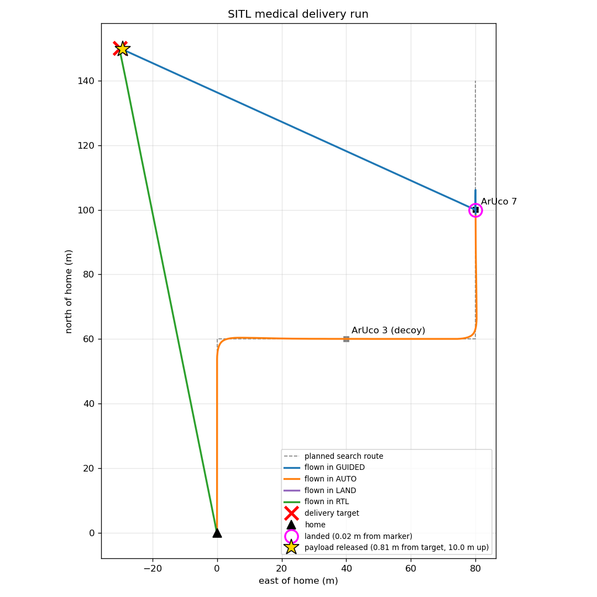
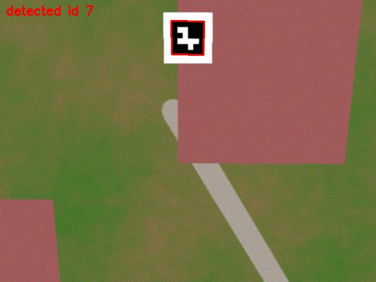
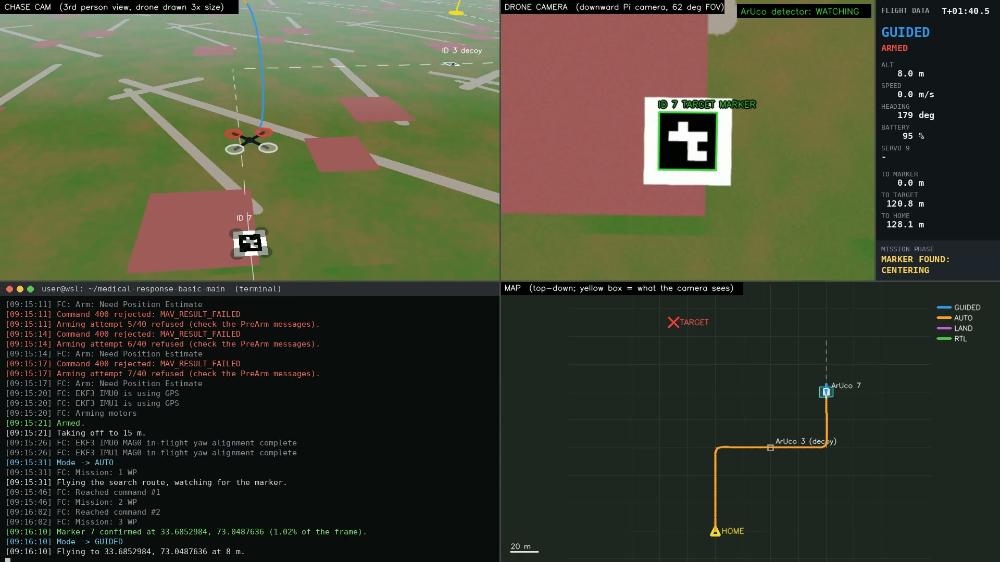

# Medical Response Drone

Autonomous medical-delivery mission for an **ArduPilot quadcopter** (Pixhawk + Raspberry Pi + Pi camera).
The drone searches a route for an **ArUco marker**, lands precisely on it, picks up a payload, flies it to a
GPS delivery point, releases it and returns home. Safety checks run the whole time, and there's a full
**ArduPilot SITL simulation** with a simulated camera and replay video.



▶ **[Full mission replay video (4 min, 1080p)](docs/media/mission_replay.mp4)**: chase cam, drone camera with live ArUco detection, flight data, the mission script's terminal output and a top-down map, all synced.

---

## Mission



1. **Pre-flight**:
   - GPS fix and satellite count
   - battery level
   - camera working
   - target within range of home
   - mission uploaded
   - home locked at the launch point
2. **Search**: take off, then fly the waypoint route in AUTO while the camera looks for the allowed ArUco ID. Other markers are ignored.
3. **Precision landing**: work out the marker's GPS position from the camera image and the drone's attitude. Hover over it, re-measure, then land.
4. **Payload**: set the servo at the marker, wait (a timed countdown, or press Enter), then re-arm.
5. **Delivery**: fly to the target GPS point, confirm arrival within the configured radius, release the payload.
6. **Return**: RTL to the original launch point.

## Simulation results

These numbers are from ArduCopter SITL, with the simulated camera and a decoy marker on the route:

| Metric | Result |
|---|---|
| Landing error from the ArUco marker | **0.01–0.02 m** |
| Payload release error from the target | **0.3–0.8 m** (at 10 m altitude) |
| Return-to-launch landing error | **0.04 m** |
| Decoy marker (wrong ID) | Ignored |
| Total flight time | About 230 s |

<p align="center">
  
  
</p>

SITL GPS is near perfect. On a real drone, expect the GPS-limited accuracy to be about 1–3 m.

## Safety behaviour

| Situation | What the script does |
|---|---|
| Camera fails before takeoff | Refuses to arm |
| Camera fails during the search | RTL |
| Battery below the limit (on the ground or in flight) | Won't launch / RTL |
| Route finished, no marker found | RTL, no delivery |
| Command refused or step timed out | RTL (or leaves the drone alone if it isn't safe to command) |
| Flight mode changed by the RC pilot or an ArduPilot failsafe | Stops sending commands and hands over control |
| Link to the flight controller lost | Leaves it to ArduPilot's own failsafes |
| Script killed or Ctrl+C | RTL. The script also sends a heartbeat, so ArduPilot's GCS failsafe can trigger. |
| Target too far from home (wrong coordinates) | Refuses to fly |

Every wait has a timeout, and every command waits for the flight controller to confirm it. The script is an extra safety layer; still configure ArduPilot's own failsafes (battery, RC, GCS, geofence).

## Hardware

- Pixhawk-class flight controller running **ArduCopter**
- Raspberry Pi as the companion computer, connected to the Pixhawk over USB or serial
- Raspberry Pi camera, **fixed to the frame, pointing straight down, with the top of the image towards the nose**
- Servo for the payload on an output channel (default 9)
- Printed ArUco marker (`DICT_4X4_50`, default ID 7, about 1.5 m)

## Repository layout

```
├── mission_config.json     # All settings: connection, route, target, servo, camera, safety
├── mission_pymavlink.py    # Run the mission with pymavlink (direct serial/UDP/TCP)
├── mission_ros1.py         # Run the mission with ROS1 + MAVROS
├── mission_flow.py         # Mission steps and safety checks (shared by both)
├── aruco_watcher.py        # Camera thread + ArUco detection (Picamera2 / webcam / sim)
├── camera_model.py         # Camera geometry: marker pixel + drone pose -> GPS position
├── mission_common.py       # Config loading, waypoint parsing, helpers
├── sim_camera.py           # Simulated downward camera for SITL
├── sim/                    # SITL simulation: world, route, launcher, recorder, plots, video
├── tests/                  # Mission tests against a simulated vehicle
├── docs/media/             # README images and video
└── legacy/                 # Original prototype scripts (reference only, do not fly)
```

## Quick start

### 1. Install (on the Raspberry Pi)

```bash
sudo apt install python3-picamera2 python3-opencv
```

```bash
pip install pymavlink numpy
```

### 2. Configure `mission_config.json`

| Key | Meaning |
|---|---|
| `connection.pymavlink_url` | e.g. `/dev/ttyACM0` (USB), `udp:127.0.0.1:14550`, `tcp:127.0.0.1:5760` |
| `connection.mavros_ns` | MAVROS namespace, e.g. `/mavros` or `/drone1/mavros` |
| `mission.waypoint_file` | Search route exported from Mission Planner / QGroundControl (`QGC WPL 110`) |
| `target.lat`, `target.lon`, `target.alt_m` | Delivery point and flight altitude |
| `target.max_distance_from_home_m` | Refuses to fly if the target is farther than this |
| `payload.servo_channel`, `pwm_at_marker`, `pwm_at_target` | Payload servo; **check these on the bench** |
| `ground.wait_s` / `ground.confirm_with_enter` | Ground stop at the marker: timed countdown, or wait for Enter |
| `aruco.allowed_ids` | Marker IDs to accept (empty = any) |
| `aruco.hfov_deg` | Camera horizontal field of view (Pi Camera v2: 62.2°) |
| `aruco.center_before_landing`, `center_alt_m` | Precision centring over the marker before landing |
| `safety.*` | Battery limits, GPS satellites, link timeout, arming attempts |

### 3. Run

pymavlink:

```bash
python3 mission_pymavlink.py
```

ROS1 / MAVROS:

```bash
roslaunch mavros apm.launch fcu_url:=/dev/ttyACM0:115200
```

```bash
python3 mission_ros1.py
```

Options for the pymavlink version: `--config`, `--url` and `--camera` (`picamera2`, `sim`, or a webcam number).

## Simulation (ArduPilot SITL, Linux / WSL)

The `sim/` folder contains a complete test world:

- **The drone:** ArduCopter SITL, home in Islamabad.
- **The camera:** a simulated downward camera that renders the ground from the drone's live position *and* tilt.
- **The markers:** the real marker (ID 7) and a decoy (ID 3) on the search route.
- **The plan:** search route `sim/route.waypoints`, target 150 m away, all settings in `sim/sim_config.json`.

To run it, you need an ArduPilot SITL build (default `~/sim-deps/ardupilot`; override with `ARDUPILOT=/path/to/ardupilot`). Then:

```bash
bash sim/run_sim.sh
```

To run a flight and also render the replay video:

```bash
VIDEO=1 bash sim/run_sim.sh
```

Results go to `sim/output/`:

| File | Contents |
|---|---|
| `mission.log` | The script's output |
| `track.csv` | Position, attitude, mode and servo at 10 Hz |
| `flight_map.png` | The flight plotted on a map |
| `summary.json` | Landing and release accuracy |
| `detections/` | Camera frames at detection |
| `mission_replay.mp4` | The 1080p replay video |

To re-render the video from the last run:

```bash
python3 sim/make_video.py sim/sim_config.json sim/output --speed 2
```

`--speed` sets the playback speed; `--still 95` writes a single frame at T+95 s instead.



## Tests

These run the whole mission against a simulated vehicle, with no hardware or ROS needed. They cover:

- a full delivery
- no marker found
- camera failure
- target too far
- low battery
- pilot takeover
- arming refused
- link lost
- the camera geometry
- waypoint parsing

```bash
python -m unittest discover -s tests -v
```

## Notes

- **ArduPilot moves home to wherever it arms.** The mission locks home at the launch point, so RTL after the delivery flight returns to base, not to the marker.
- **Recent ArduPilot master renamed `WPNAV_SPEED` (cm/s) to `WP_SPD` (m/s).** `sim/sim.parm` sets both.
- **Raspberry Pi OS ships OpenCV 4.6.** The ArUco code supports both the old (< 4.7) and new OpenCV APIs.
- **`legacy/` holds the first prototype scripts.** They have known bugs (wrong altitude frames, broken mode commands, unsafe arming loops) and are kept only for reference.
